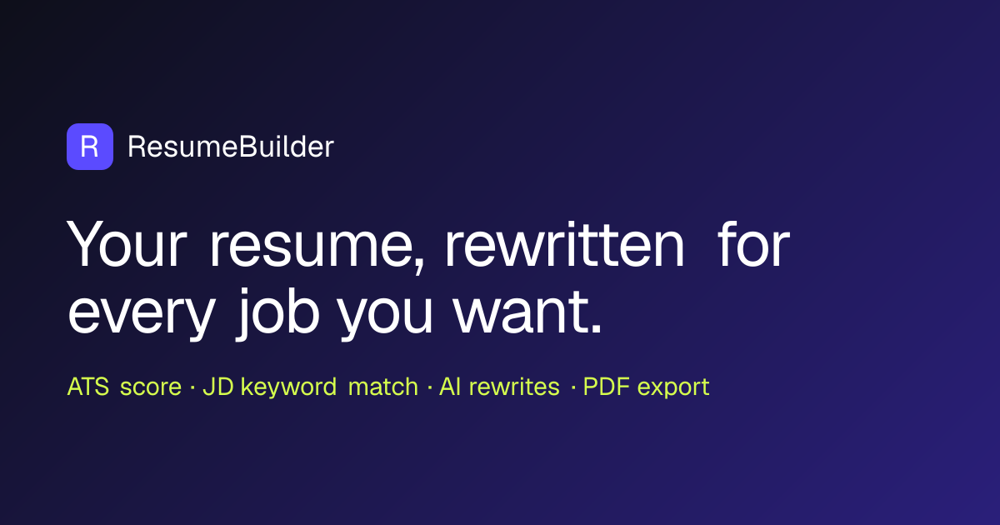

# ResumeBuilder: AI resume tailoring with ATS scoring



**Live demo:** https://resume-maker-brown.vercel.app

ResumeBuilder tailors a resume to a specific job description. Paste a job post and the app pulls out the keywords recruiters and ATS systems look for, then shows how well your resume matches them. It rewrites your bullets around those keywords and exports a clean PDF. The AI only works with facts from your own profile, so it never makes up employers, dates or metrics.

## Features

- **Three ways to start:** upload an existing resume (PDF or DOCX), generate one from a job description, or start from scratch.
- **Job description analysis:** pulls out hard skills, soft skills and must-have vs nice-to-have keywords, including the different ways each one gets written (e.g. React.js / ReactJS).
- **Keyword match:** shows which keywords from the job post your resume already covers and which are missing.
- **ATS score:** 12 checks, covering complete contact info, action verbs, quantified results, bullet length, valid dates, reverse-chronological order and page length.
- **AI writing help:** rewrite single bullets, improve the summary, and write a 250-350 word cover letter for the role.
- **20+ templates** with a live preview, layout controls and one-click PDF export.
- **Autosave:** your work stays in the browser between visits, and you can import or export it as JSON.

## Tech stack

| Area | Tools |
|---|---|
| Frontend | Next.js 16 (App Router), React 19, TypeScript, Tailwind CSS 4 |
| State and forms | Zustand (persisted), React Hook Form, Zod |
| AI | Anthropic Claude API, structured JSON output validated with Zod |
| Documents | `@react-pdf/renderer` for export, `pdf-parse` and `mammoth` for import |
| Backend | Next.js route handlers, Supabase (waitlist), per-IP rate limiting |
| Hosting | Vercel |

## How it works

```
Job description ─► /api/analyze-jd ─► keywords + importance
                                          │
Your profile / uploaded resume ─► /api/parse-resume ─► structured resume (Zod-validated)
                                          │
              ┌───────────────────────────┼──────────────────────────┐
              ▼                           ▼                          ▼
     /api/rewrite-bullet        /api/generate-resume       /api/generate-cover-letter
              │                           │                          │
              └──────────► live preview + ATS score ─► PDF export ◄──┘
```

Every AI route returns JSON, which is validated against a Zod schema before it reaches the UI. Each route sits behind a rate limiter to keep API costs under control.

## Run locally

```bash
git clone https://github.com/AbhinavSinghRaj/resume-maker.git
cd resume-maker
npm install
```

Create `.env.local`:

```
ANTHROPIC_API_KEY=your-anthropic-key
# Optional, only needed for the landing-page waitlist:
SUPABASE_URL=your-supabase-url
SUPABASE_SERVICE_ROLE_KEY=your-service-role-key
NEXT_PUBLIC_SITE_URL=http://localhost:3000
```

Then run:

```bash
npm run dev
```

Open http://localhost:3000. For the waitlist table, run `supabase/signups.sql` once in the Supabase SQL editor.

## Project structure

```
src/
  app/            pages (landing, builder, templates) and API routes
  components/     forms, preview, templates, ATS and JD panels, PDF export
  lib/            AI prompts, Zod schemas, ATS rules, templates, rate limiter
  store/          Zustand resume store
supabase/         SQL for the waitlist table
```

## Author

Built by **Abhinav Singh Rajput**, a senior full-stack engineer (React, Next.js, Node.js, AWS) who builds AI-powered web products.
[LinkedIn](https://linkedin.com/in/abhinav-singh-rajput-4229ab25a) · Open to freelance and contract work.
